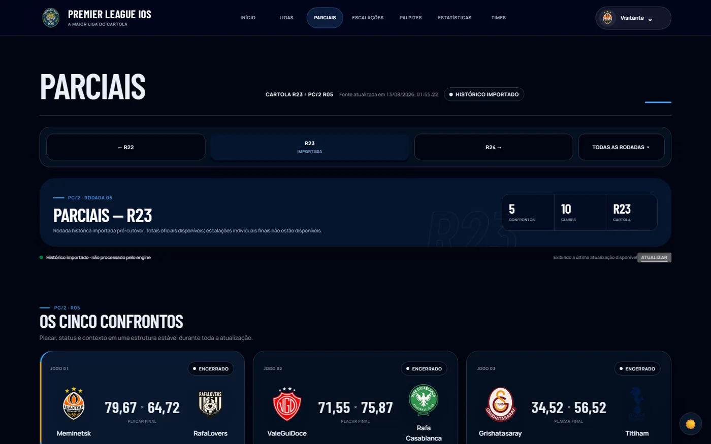
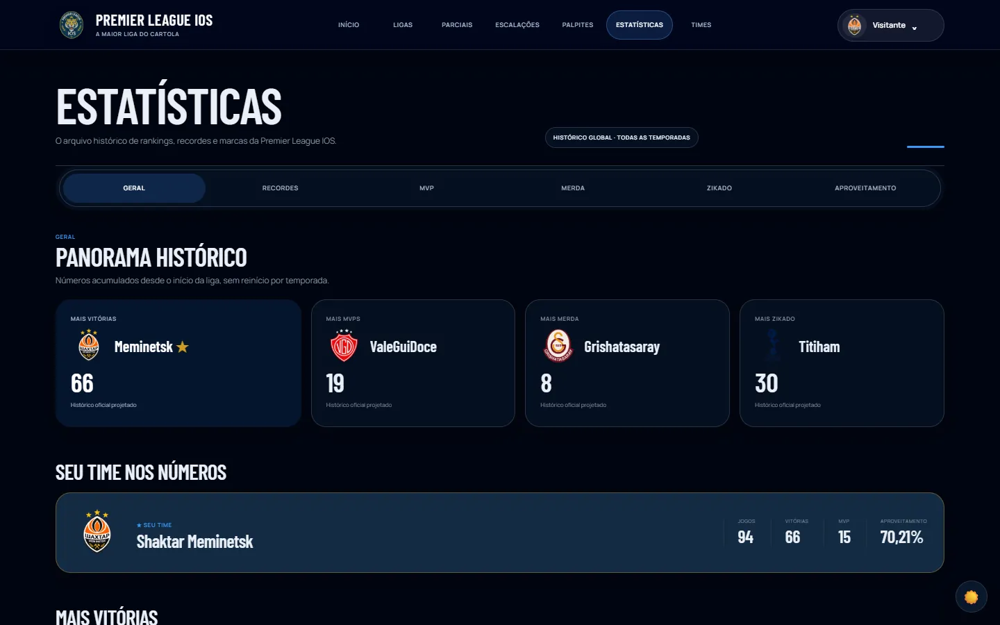
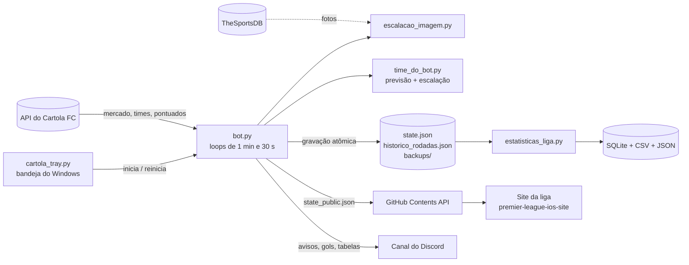

<div align="center">


# Premier League IOS Bot

**O bot de Discord que transforma uma liga de amigos no Cartola FC em um campeonato de verdade:**
**rodadas acompanhadas sozinhas, gols ao vivo, tabelas, recordes e um site alimentado automaticamente.**


</div>

---

## O que é

O **Premier League IOS Bot** é o "juiz, narrador e estatístico" de uma liga privada de Cartola FC.
Ele roda no PC de um dos participantes, consulta a API pública do Cartola a cada minuto e cuida de
tudo o que antes era feito à mão em planilha:

- avisa quando o mercado vai fechar e marca quem ainda não escalou;
- narra os gols e assistências da rodada em tempo real, dizendo quais times da liga têm o jogador;
- fecha a rodada, calcula confrontos de pontos corridos, MVP, pior pontuação, jejum e aproveitamento;
- grava um histórico permanente (JSON + SQLite + CSV) e publica um **estado público** que o
  site da liga consome.

Tudo foi pensado para um cenário real e imperfeito: o PC desliga, a internet cai, a API do Cartola
demora a consolidar as pontuações. O bot foi construído para **não perder rodadas e não duplicar dados**.

## O que o bot alimenta

O bot gera o `state_public.json` que abastece o site da liga (projeto irmão **`premier-league-ios-site`**).

<p align="center">
  <br>
  <sub>Site da liga — página de <b>Parciais</b>, alimentada pelo estado público publicado pelo bot.</sub>
</p>

<p align="center">
  <br>
  <sub>Site da liga — página de <b>Estatísticas</b> (vitórias, MVPs, jejum e aproveitamento) calculadas pelo bot.</sub>
</p>

## Recursos

| Área | O que faz |
|---|---|
| **Mercado** | Avisos com 24h, 12h, 1h e 10min do fechamento, mencionando só quem não escalou; envia apenas o aviso mais próximo se o bot ligar atrasado. |
| **Rodada ao vivo** | Loop de 30s em `/atletas/pontuados`: detecta gols e assistências, junta o gol com a assistência do mesmo clube e mostra capitão e reserva de luxo de cada time da liga. |
| **Time mais escalado** | No fechamento do mercado, monta a seleção mais escalada da liga e gera uma **imagem do campo** com Pillow (fotos, escudos e selos, com cache local). |
| **Time do bot** | Uma hora antes do fechamento, o bot escala o próprio time com o patrimônio médio da liga (previsão por média, mando, tabela e forma) e depois compara o resultado com os humanos. |
| **Fechamento** | Confrontos dos pontos corridos (PC/1 e PC/2), MVP, pior da rodada, jejum ("zikado"), aproveitamento, marcos históricos (50/100/150/200), recordes e anúncio automático de campeões. |
| **Histórico** | Ranking global de pontuações (`!recorde`, paginado com botões), tabelas, copa, mundial e página de cada clube. |
| **Estatísticas** | Banco SQLite + CSVs + JSON público regenerados a cada rodada, sem duplicar nada. |
| **Site** | Publica `state_public.json` localmente e, se configurado, direto no repositório do site via GitHub Contents API. |
| **Operação** | Ícone na bandeja do Windows, início com o sistema, backups por rodada e painel `!admin` com a saúde do bot. |

## Destaques técnicos

### Recuperação de rodadas perdidas enquanto offline
- Na inicialização, `_sincronizar_inicio` compara a rodada atual do Cartola com `last_processed_round`.
  Se faltar **só a rodada anterior**, ela é recuperada direto da API.
- Se faltarem várias, o bot recupera **em ordem** as que existirem em `rodadas_manuais.json`
  (placares conferidos) e, para o resto, marca `recovery_required` e avisa no canal:
  *ele nunca inventa dados nem pula rodadas*.
- `processar_rodada_finalizada` é o **único ponto de escrita** do fechamento: recusa rodada incompleta,
  rodada já processada, buraco na sequência e pontuações suspeitas (tudo zerado ou idêntico à rodada
  anterior, sinal de que a API ainda não consolidou) — e tenta de novo no minuto seguinte.
- Gols que aconteceram com o bot desligado viram um único resumo ("o que rolou enquanto o bot estava offline").

### Estatísticas idempotentes
- `estatisticas_liga.py` grava no SQLite com **chaves primárias** `(season, competition, round, team_id)`
  e `INSERT ... ON CONFLICT DO UPDATE`: rodar de novo a mesma rodada **atualiza, não duplica**.
- Só as campanhas das competições presentes no estado são recalculadas; temporadas antigas ficam intactas.
- CSVs e JSON são escritos em arquivo temporário e trocados com `os.replace`, para nunca ficarem pela metade.
- `python gerar_estatisticas.py` regenera tudo sem conectar ao Discord.

### Estado durável e à prova de falhas
- `state.json` e `historico_rodadas.json` são gravados de forma **atômica** (temporário + `fsync` + `os.replace`).
- Snapshot em `backups/<ano>/state_RXX.json` a cada rodada; se o `state.json` corromper, o bot **restaura
  sozinho** o último backup válido e avisa o administrador por DM.
- Os anúncios do fechamento entram numa **fila persistente** no estado: se o Discord falhar, eles são
  reenviados nos minutos seguintes (até 60 tentativas), na ordem certa.

### Publicação do estado público para o site
- `publicar_site_estado()` monta uma projeção pública (sem tokens nem dados internos) com tabelas,
  confrontos, histórico, conquistas e resumo de recordes.
- Sem `GITHUB_TOKEN`, gera só o arquivo local; com token, faz `GET` do `sha` e `PUT` no repositório do site.

### Bandeja do Windows
- `cartola_tray.py` (pystray) roda o bot sem console, com ícone verde/vermelho e menu
  **Reiniciar / Abrir pasta / Logs / Logs de erros / Desligar**.
- Instância única por trava de socket local, espera a internet voltar após o boot e
  `--instalar` cria a inicialização automática com o Windows.

## Arquitetura



## Comandos principais

| Comando | Descrição |
|---|---|
| `!ajuda` | Lista os comandos por categoria |
| `!tabela` • `!status` • `!mercado` | Classificação geral, quem escalou e situação do mercado |
| `!nacional [rodada\|mes\|patrimonio]` | Times da liga no ranking nacional do Cartola |
| `!cartoleta` • `!capitao` • `!reservadeluxo` | Patrimônio, capitães e reservas de luxo da rodada |
| `!pc` • `!pc1` • `!pc2` • `!confrontos [rodada\|time]` • `!forma` | Pontos corridos: tabela, calendário e forma recente |
| `!copa [ano]` • `!mundial [ano]` • `!campeonatos` • `!temporada` | Mata-mata, mundial, arquivo de campeonatos e panorama da temporada |
| `!mvp` • `!merda` • `!zikado` • `!aproveitamento` • `!recorde` | Rankings históricos |
| `!times` • `!biografia` • `!<clube>` | Clubes da liga e a página de cada um (gerada a partir de `liga_dados.py`) |
| `!admin` • `!admin importar` | Saúde do bot (Cartola, GitHub, state, backups) e validador de campeonato — só para o administrador |

## Instalação

Requisitos: **Python 3.10+** e um bot criado no [Discord Developer Portal](https://discord.com/developers/applications)
com a intent *Message Content* ativada.

```powershell
git clone <url-deste-repositorio>
cd premier-league-ios-bot
python -m venv .venv
.\.venv\Scripts\Activate.ps1
python -m pip install -r requirements.txt
Copy-Item .env.example .env
```

## Configuração

1. **`.env`** — preencha `DISCORD_TOKEN`, `DISCORD_CHANNEL_ID` e `ADMIN_DISCORD_ID`.
   O restante é opcional (publicação no site, pasta das estatísticas etc.; veja os comentários no `.env.example`).
   O token também pode ficar em um `token.txt` na pasta do bot.
2. **Dados da liga** — `liga_dados.py` traz uma liga **fictícia** de exemplo (10 times, calendário gerado
   pelo método do círculo e resultados determinísticos). Para a sua liga, crie **`liga_dados_local.py`**
   redefinindo as mesmas constantes (`TIMES` com o ID do Discord e o ID do time no Cartola de cada
   participante, calendário, histórico, textos) e `DADOS_DE_EXEMPLO = False`. Esse arquivo é carregado
   automaticamente e fica fora do git.
3. **Estatísticas** — por padrão vão para `./estatisticas`; defina `ESTATISTICAS_LIGA_DIR` para outra pasta.

> O bot se recusa a iniciar com os dados de exemplo, para não consultar times aleatórios do Cartola
> por engano. Para testar mesmo assim, use `PERMITIR_DADOS_EXEMPLO=1`.

## Execução

```powershell
python bot.py                    # no terminal

python -m pip install -r requirements-tray.txt
python cartola_tray.py           # na bandeja do Windows
python cartola_tray.py --iniciar # em segundo plano, independente do terminal
python cartola_tray.py --instalar     # abrir junto com o Windows
python cartola_tray.py --desinstalar
```

Ferramentas de linha de comando (com o bot parado):

```powershell
python gerar_estatisticas.py              # regenera SQLite/CSV/JSON a partir do state.json
Copy-Item exemplos\rodadas_manuais.example.json rodadas_manuais.json
python lancar_rodadas.py --dry-run        # valida rodadas digitadas à mão
python lancar_rodadas.py                  # processa com a mesma rotina do bot (com backup antes)
```

## Testes

```powershell
python bot_readiness_test.py
```

Teste **offline** (não conecta ao Discord nem ao Cartola): compila o bot, confere os comandos essenciais
via AST, valida os contratos de `backend_consumer.py`, importa uma **cópia isolada** do bot em pasta
temporária e garante que os JSON canônicos não foram alterados e que nenhum token aparece na saída.

## Estrutura

```
premier-league-ios-bot/
├── bot.py                    # bot Discord: loops, fechamento de rodada, comandos
├── liga_dados.py             # dados da liga (versão pública fictícia)
├── cartola_api.py            # cliente da API do Cartola com novas tentativas
├── estatisticas_liga.py      # SQLite + CSV + JSON idempotentes
├── escalacao_imagem.py       # imagem do "time mais escalado" (Pillow)
├── time_do_bot.py            # previsão de pontos e escalação dentro do orçamento
├── cartola_tray.py           # ícone na bandeja do Windows
├── lancar_rodadas.py         # lançamento manual seguro de rodadas
├── gerar_estatisticas.py     # regenera as estatísticas sem Discord
├── backend_consumer.py       # contratos offline para um futuro backend read-only
├── bot_readiness_test.py     # teste offline
├── exemplos/                 # arquivos de exemplo com dados fictícios
├── assets/logo-premier.png
├── docs/img/                 # capturas do site da liga
├── .env.example
└── requirements*.txt
```

Arquivos gerados em execução (`state.json`, `state_public.json`, `historico_rodadas.json`, `backups/`,
`cache/`, `estatisticas/`, logs) ficam fora do controle de versão.

## Projeto irmão

- **`premier-league-ios-site`** — o site da liga, que consome o `state_public.json` publicado por este bot.

## Licença

Distribuído sob a licença MIT. Consulte [LICENSE](./LICENSE).
